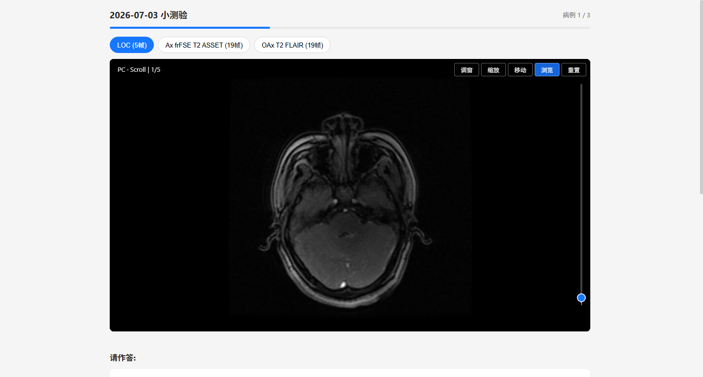
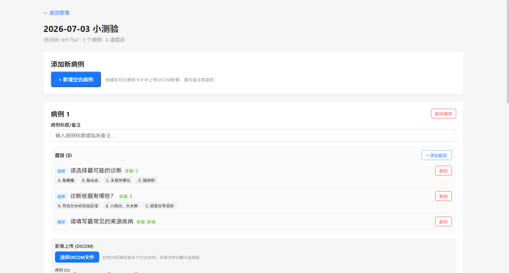
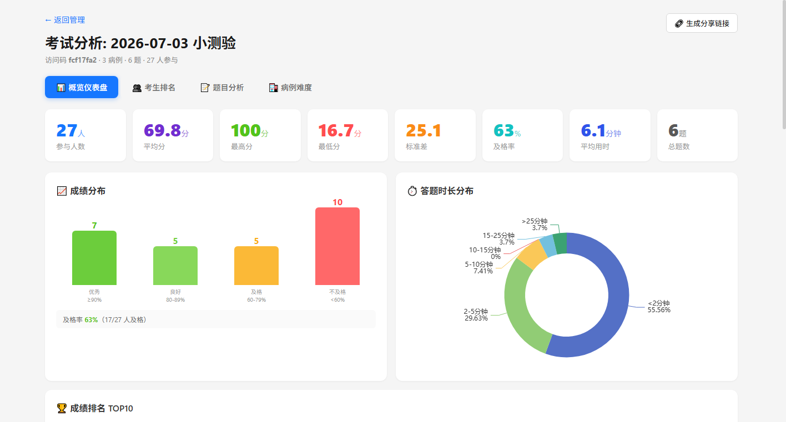
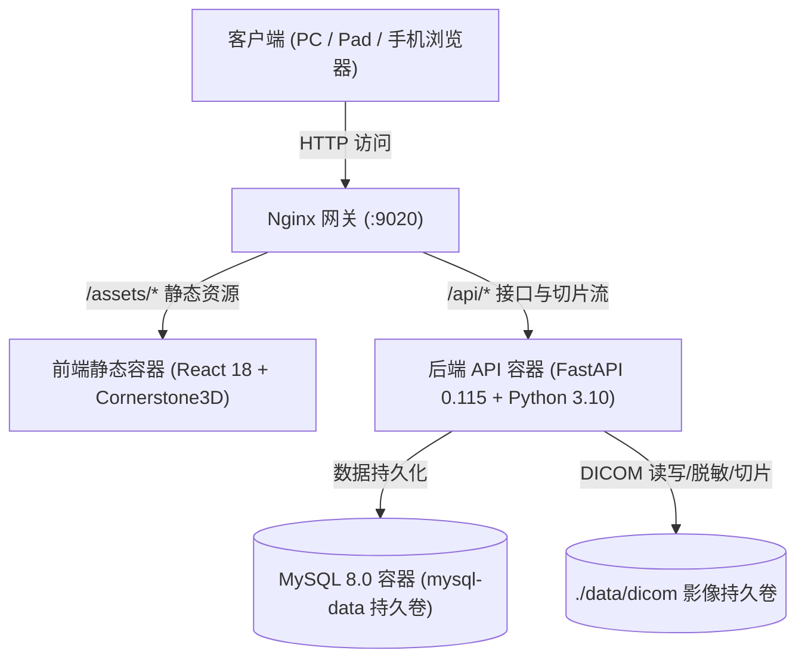

# 放射科医学影像在线问卷与考核评估系统 (Radiology Exam System)

<p align="center">
  
  
  
  
  
  
  
</p>

面向放射科、影像学教研室、住院医师规范化培训（规培）及医学技能竞赛场景打造的**现代化开源 DICOM 在线阅卷与问卷考核评估系统**。

管理员可直接批量上传真实 DICOM 影像序列、在线编排病例与试题并发布考核；考生只需通过电脑或移动端浏览器打开答题链接，即可直接在网页端流畅进行专业级 DICOM 影像浏览（切片滚动、窗宽窗位调整、缩放、平移等）并作答，交卷后即刻评卷并查看成绩解析。系统同时配备四维可视化教学统计分析仪表盘，全面支持多级权限管控与独立安全单机部署。

---

## 🌟 核心功能一览与界面展示

### 1. 专业级 DICOM 浏览器与考生答题界面
内置基于 WebGL / GPU 加速的 **Cornerstone3D** 现代医学影像视口，原生支持多序列无缝切换、PC 滚轮与移动端触控滑块连续切片浏览、WW/WC（调窗）、缩放、平移及一键复位。页面针对考试体验深度优化，支持进度续答与答案锁定防作弊。



### 2. 交互式病例题库编排与试卷设计器
支持一个病例挂载多个 DICOM 序列（如定位相、T1WI、T2WI、DWI 等），支持 ZIP 压缩包或散装 `.dcm` 文件一键上传与后端自动解析。试题支持单选题、多选题、填空题混合编排，支持题目与分值动态配置。



### 3. 四维教学与考核统计分析仪表盘
提供考试概览、考生排名、题目正答率深度归因、病例难度梯队分析四个维度的综合仪表盘。内置生成只读 **分享 Token**，方便无需管理员账号即可将考核统计报表安全分发给教研室同行或评审专家。



---

## ✨ 核心特性

- 🩺 **专业级医学影像视口**：集成 Cornerstone3D (v2.13)，利用浏览器 GPU 硬件加速渲染，支持交互式调窗、切片滚动、平移缩放，阅片性能丝滑稳定。
- 🛡️ **自动化患者隐私脱敏**：后台在接收上传的 DICOM 文件时，自动剥离患者姓名（PatientName）、患者ID（PatientID）、出生日期等 HIPAA / 医疗法规敏感标签，确保临床数据合规安全。
- 💡 **DR/CR 智能反色校正**：自动识别 `MONOCHROME1` 光度学解释并进行反转计算，彻底解决普通 Viewer 中 X 光片背景变白、骨骼变黑的问题，完美契合放射医师阅片习惯。
- ⚡ **DICOM 极速后台预取**：考生进入信息登记页时，系统自动在后台并行预取全套病例影像帧数据，考生点击开始答题后实现秒级首帧呈现、零卡顿切片。
- 📝 **全流程考核防作弊与续答**：支持单选、多选、文本填空及多答案容错自动判分；答题进度自动留存，答完病例即刻锁定防止篡改，意外断网重登可无缝续答。
- 👥 **多级管理员权限隔离**：超级管理员可统筹全部试卷并纳管管理员用户；普通教研员仅可管理自己创建的问卷；支持超管随时一键启闭“管理员自主注册”开关。
- 📦 **纯净单机容器化架构**：内置标准 `docker-compose.yml`，全量集成优化版 MySQL 8、FastAPI 异步后端、Vite React 静态前端与 Nginx 网关，解耦所有外部中转机制，任何标准 Docker 环境一键即起。

---

## 🚀 极速部署指南 (Docker Compose)

系统已完成全部隐私脱敏与解耦配置，支持在任意干净的 Linux / macOS / Windows Docker 环境中单机独立运行。

### 1. 克隆代码仓库

```bash
git clone https://github.com/your-repo/radiology-exam.git
cd radiology-exam
```

### 2. 检查与准备环境变量

项目根目录已附带可开箱即用的 `.env` 与模版 `.env.example`。你可以直接使用默认配置，或按需调整端口与密钥：

```bash
cp .env.example .env
```

> **默认超级管理员账号信息**：
> - 登录账号：`user`
> - 初始密码：`admin`
> - *(首次启动容器时系统会自动检测并初始化该超级管理员账号)*

### 3. 一键构建并启动服务

```bash
docker compose up -d
```

启动完成后，可查看服务运行状态与日志：

```bash
docker compose ps
docker compose logs -f backend
```

当看到 `[database] Database tables initialized successfully.` 与 `[startup] Root superadmin account 'user' created.` 即表示系统就绪。

### 4. 访问系统

| 模块 | 访问地址 | 默认凭证 / 说明 |
| :--- | :--- | :--- |
| **管理后台登录** | `http://<服务器IP或localhost>:9020/admin/login` | 账号：`user`，密码：`admin` |
| **管理后台控制台** | `http://<服务器IP或localhost>:9020/admin/dashboard` | 试卷列表、创建问卷、生成二维码 |
| **考生答题入口** | `http://<服务器IP或localhost>:9020/exam/<访问码>` | 考生凭访问码直接登记并开始作答 |
| **统计只读分享** | `http://<服务器IP或localhost>:9020/admin/exams/<ID>/statistics?share_token=<TOKEN>` | 外部免密只读查看该场考试统计 |
| **系统健康检查** | `http://<服务器IP或localhost>:9020/api/health` | 返回 `{"status":"ok",...}` |

---

## ⚙️ 环境变量详细配置 (`.env`)

所有关键配置均由环境变量控制，主要配置项如下：

```ini
# ==============================================================================
# 服务端口与网关配置
# ==============================================================================
PORT=9020                                      # Nginx 宿主机对外映射访问端口

# ==============================================================================
# 数据库配置（单机 Docker 部署默认自动互联内置 db 容器服务）
# ==============================================================================
DB_HOST=db                                     # 数据库主机（Docker 内部服务名为 db）
DB_PORT=3306                                   # 数据库端口
DB_NAME=radiology_exam                          # 数据库名称
DB_USER=radiology                               # 数据库用户
DB_PASSWORD=radiology123                       # 数据库密码
DB_ROOT_PASSWORD=radiology_root_secret         # MySQL root 管理密码

# ==============================================================================
# 初始超级管理员配置（初次部署启动自动建号）
# ==============================================================================
ADMIN_USERNAME=user                            # 默认超管登录用户名
ADMIN_PASSWORD=admin                           # 默认超管登录密码

# ==============================================================================
# 安全与上传配置
# ==============================================================================
SECRET_KEY=radiology-exam-secret-key-change-in-production-2026 # JWT 签名密钥（生产建议更换）
UPLOAD_MAX_SIZE_MB=500                         # DICOM 影像及压缩包单次上传限制 (MB)
```

---

## 🏗️ 系统架构与数据存储

### 1. 架构拓扑



### 2. DICOM 处理与切片分发机制

- **解压与校验**：管理端上传 ZIP 或 DCM 后，服务端提取每一帧 DICOM 文件，计算哈希并去重。
- **脱敏与归档**：使用 `pydicom` 擦除患者姓名、住院号等元数据，按 `data/dicom/case_{uuid}/series_{index}/` 目录物理归档。
- **高性能帧切分与 304 缓存**：后端为每个 Series 预先抽取第一帧生成缩略图（`thumbnail.jpg`），同时生成匿名 `.dcm` 帧文件；通过 HTTP `Cache-Control: public, max-age=86400` 与 ETag / 304 机制确保重复切片加载消耗极小带宽。
- **纯正同源分发**：前端 DICOM Viewer 直接请求 `/api/dicom/*` 接口，无需任何第三方中转服务器，安全性与传输可靠性达到生产要求。

---

## 🛠️ 本地研发与手动构建

若需进行二次开发或定制功能，可按照以下步骤在本地运行各组件：

### 前端开发环境 (Node.js 20+)

```bash
cd frontend
npm install
npm run dev
# 前端 Vite 热重载服务运行在 http://localhost:5173
```

### 后端开发环境 (Python 3.10+)

```bash
cd backend
python -m venv venv
source venv/bin/activate  # Windows: venv\Scripts\activate
pip install -r requirements.txt

# 启动本地 FastAPI
uvicorn app.main:app --host 0.0.0.0 --port 8000 --reload
```

### 运维与重新发布脚本 (`deploy.sh`)

项目内置了便捷运维脚本：

```bash
./deploy.sh all        # 重新编译前后端并重启整个集群服务
./deploy.sh backend    # 仅重新构建并热更新后端服务
./deploy.sh frontend   # 仅重新构建并热更新前端服务
./deploy.sh nginx      # 测试并重启 Nginx 网关
```

---

## 🔒 生产环境安全与运维建议

1. **修改默认凭证**：在接入公网或生产运行前，请务必在 `.env` 中修改 `ADMIN_PASSWORD`、`SECRET_KEY` 及 `DB_PASSWORD`。
2. **启用 HTTPS**：推荐在上层反向代理（如 Nginx、Traefik、Caddy 或云厂商 ALB）配置 SSL 证书，并反向代理至本机的 `9020` 端口。
3. **数据备份**：
   - 数据库：定期备份 Docker volume `mysql-data` 或执行 `mysqldump`。
   - 医学影像：定期备份宿主机挂载的 `./data/dicom` 目录。
4. **磁盘空间管理**：系统已内置级联清理机制——当管理员在后台删除问卷、病例或序列时，对应的物理 DICOM 影像文件会立即同步释放，避免磁盘闲置占用。

---

## 📄 开源许可证

本项目采用 [MIT 许可证](LICENSE) 开源，欢迎广大学术机构、医院科室及开发者自由使用、扩展与贡献。
